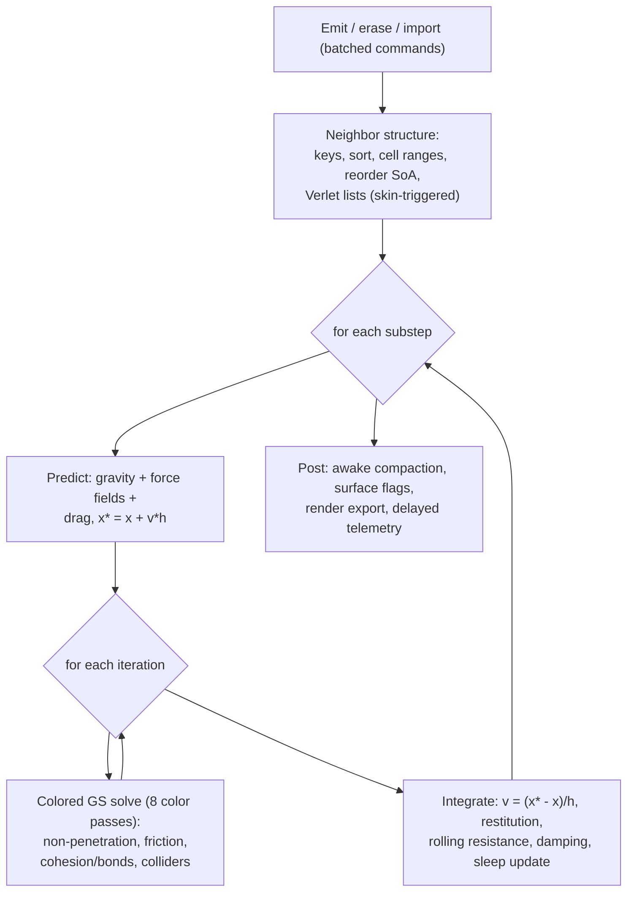
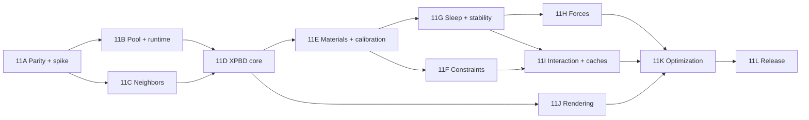

# VParticles Granular Roadmap: Houdini-Class, Real-Time Sand (Phase 11, v2)

**Status:** Phase 1 (Effects Engine, Phases 0–10B) complete. Phase 11 (Granular) ready to begin. Next step: **Phase 11A**.
**Hardware baseline:** RTX 3050 6GB Laptop GPU (20 SMs, 168 GB/s), same as all prior phases.

**Two governing requirements for every decision below:**

1. **As close to Houdini as possible.** Concretely: match the behavior and artist-facing controls of Houdini's particle-based grain solver (Vellum Grains / POP Grains lineage).
2. **Fast.** Real-time, millions of grains, with every phase gated on a measured performance budget.

---

## Pre-Build Analysis: Technology Separation Decision

> Recorded 2026-10-02 before Phase 11A begins. Decision is final unless a gate overturns it.

**Question asked:** Does any component of Phase 11 warrant extraction as a separate standalone project first (analogous to VGrid before grid-based sims)?

**Answer: No.**

Every significant new technology in Phase 11 either belongs exclusively inside VParticles or is already covered by an existing library (CUB). Detailed reasoning:

| Candidate | Decision | Rationale |
| --- | --- | --- |
| GPU radix sort + keyed SoA reorder | **Stay in-project** | The novel part is one ~50-line reorder kernel, tightly coupled to `GranularPool` layout. The sort itself is CUB `DeviceRadixSort`, already a dependency. Not general enough to warrant a standalone library. |
| Verlet neighbor list build | **Stay in-project** | Grain-specific slot count (32), grain-specific key format, grain-specific overflow policy. Reusability outside VParticles is zero. |
| `GranularPool` / XPBD contact core | **Stay in-project** | This *is* the simulation mode. It lives behind the narrow `ContactSolver` interface for replaceability, not for extraction. |
| Cell-colored Gauss-Seidel | **Stay in-project** | A solve strategy, not a reusable library. Coloring is prepared during neighbor sort, not a separate system. |
| Sphere impostor renderer | **Stay in-project** | Extends the existing OpenGL viewer (`VParticlesViewer.exe`). No new executable needed. |
| DEM reference solver (11A) | **Throwaway spike** | Calibration tool only; never promoted to production. |
| Point-cache I/O (PLY / Alembic) | **Stay in-project** | A few hundred lines of serialization, coupled to `GrainPool` attribute names. |

**Conclusion:** Proceed directly into Phase 11A. No prerequisite separate project is needed.

---

## 0. Goal and Definition of Done

**Goal.** A real-time, particle-only granular simulation mode in VParticles that reproduces the bulk behavior and control surface of Houdini Grains, runs one to two orders of magnitude faster, and uses **no grid-based simulation** (no MPM, FLIP/PIC, heightfield or voxel sand).

**Done means all of these are true:**

1. **Parity.** On the parity scenario set (Section 7), our results match Houdini Grains reference captures within the tolerances in Section 7.2, and parameter changes move results in the same direction and similar magnitude.
2. **Speed (RTX 3050 Laptop, targets to be confirmed by 11A):**
   - Tier 1: 250K grains fully awake at 60 Hz.
   - Tier 2: 1M grains at 60 Hz with >= 80% asleep.
   - Tier 3 (stretch): 1M fully awake at 30 Hz.
   - "Faster than Houdini" is reported as a measured ratio on identical scenes, never assumed.
3. **Feature set** (Houdini-competitive): friction, rolling resistance, polydispersity, cohesion/clumping, breakable glue bonds, wind/vortex/attractor/turbulence fields, ground vibration, kinematic colliders, emitters/sinks, point-cache import/export.
4. **Engineering quality:** deterministic mode, regression-tested scenario suite with numeric criteria, reproducible benchmark commands, Nsight-backed reports, and a milestone doc per phase.
5. **Demo:** `VParticlesViewer.exe --sand` with opaque lit grains and at least eight presets.

---

## 1. Scope Decisions

### 1.1 What "no grids" means
Particle-particle interaction needs a neighbor-search structure. We use a uniform spatial hash / cell list for **queries only**: transient, no physical state, no grid-to-particle transfer. That is allowed. A grid *solver* is not.

### 1.2 What "Houdini" means here
Houdini's particle grain solvers are, to my understanding, position-based (PBD family). This plan targets **Grains parity, not MPM parity.** Houdini's hero-quality MPM sand is grid-based and excluded by your constraint. The honest ceiling is therefore Vellum-Grains-grade sand. **Assumption to verify in 11A:** the exact solver internals and parameter list, from SideFX documentation and by running Houdini on the reference scenes. If a Houdini license is not available, parity falls back to published granular data plus the DEM reference.

### 1.3 In scope
Sphere grains (polydisperse), XPBD contacts, Coulomb friction, rolling resistance, restitution, cohesion, glue bonds and clumps, force fields, kinematic colliders, sleeping, adaptive substepping, deterministic mode, sand-specific rendering, point-cache I/O.

### 1.4 Out of scope
MPM/FLIP/SPH/continuum solvers; sand surface meshing; real-scale (0.2 mm) grains; two-way rigid-body coupling (stretch, Section 13); fluids; fracture; multi-GPU.

---

## 2. Solver Decision (locked, with an escape hatch)

**Locked runtime solver: substepped XPBD ("small steps") with a gather-style contact core and cell-colored Gauss-Seidel.**

| Option | Role | Why |
| --- | --- | --- |
| **XPBD, substepped, cell-colored Gauss-Seidel** | **Runtime solver** | Same family as Houdini Grains; unconditionally stable at real-time dt; supports compliant constraints (cohesion, bonds, soft coupling) in one solve; GPU-friendly; faster convergence in deep piles than plain Jacobi |
| XPBD, plain Jacobi (gather-style) | **Baseline / debug path** | Simplest, fully parallel, no coloring pass. Slow stack convergence; kept to measure what coloring buys |
| Velocity-level TGS-soft style | **Escape hatch** | Better friction and stacking; heavier per contact; needs contact persistence. Used only if gate G2 fails |
| DEM (spring-dashpot, Hertz-Mindlin) | **Reference only** | Most physically accurate; needs 20-50+ substeps; used at 5K-20K grains for calibration and as ground truth |
| MPM / grid | Excluded | Violates the no-grid requirement |

**Why this does not trap us (the "don't choose a solver we have to change later" rule):**

- Everything except the contact core is solver-independent: pool, neighbor structure, materials, emitters, colliders, force fields, sleeping, rendering, validation, caches.
- The contact core sits behind a narrow `ContactSolver` interface (`solve(pool, neighbors, params)`), so replacing it is a contained change.
- The design carries the data a velocity-level solver would need **from day one**: a stored Verlet-style neighbor list and **stable grain IDs** that survive reordering. This costs memory (about +128 B/grain) but removes the need for a layout rewrite later.
- The 11A spike is a **confirmation** of XPBD with colored Gauss-Seidel against the Jacobi baseline and TGS-soft, with scoring criteria written before running (Section 6, 11A).

**Known XPBD limitation (accepted):** friction and energy loss depend on substep and iteration counts, not on measured material constants. Calibration against the DEM reference and Houdini captures (11E) is therefore a first-class deliverable.

---

## 3. What Sand Changes in the Engine

| Current engine assumption | Sand reality | Consequence |
| --- | --- | --- |
| Particles independent; one fused pass per frame | Contacts require dependent passes | Many kernels per substep; CUDA Graphs (Phase 8) become essential |
| Lifetime kill, free-list churn | Grains are immortal | Free-list serves only emit/erase |
| Stable slots + `activeIndices` indirection | Neighbor reads need spatial coherence | Dense, spatially sorted SoA with periodic reorder |
| Packed mode (int16 positions, fp16 velocity) | Contacts resolve sub-radius overlap | **Packed mode is unusable for sand.** At `--tile-scale 100`, position resolution is 0.01 world units, comparable to a grain radius. Granular mode is FP32 only |
| Multi-tile migration | Contacts across tile edges need halos | Granular mode is one origin-relative FP32 domain |
| Streaming single pass, ~57-113 B/particle | Gather-heavy, several iterations and substeps | 10-30x more traffic per particle; **sleeping is the main scaling lever** |
| Additive point sprites | Opaque, lit, depth-correct grains | New impostor shader path, surface-grain culling |
| 64-recipe constant table | Per-material grain parameters | Reuse the pattern: `systemId` becomes `materialId`; `GrainMaterial` table in constant memory |

Carried over unchanged: batched spawn commands, counter-based deterministic RNG, delayed telemetry ring, CUDA Graph capture and device-side `GraphParams`, CUB compaction (for awake lists), benchmark matrix/CSV tooling, viewer CUDA-GL interop.

---

## 4. Target Architecture

### 4.1 Frame pipeline



B to F is captured in one CUDA Graph. **Caveat:** graph grid sizes are fixed at capture, so awake-only kernels launch over awake-list capacity and early-out from a device-side count. Substep and iteration counts are graph topology (changing them rebuilds); `dt`, forces and collider motion go through device `GraphParams` and do not.

### 4.2 Memory layout (FP32 SoA, dense, sorted)

| Array | Bytes | Notes |
| --- | ---: | --- |
| `pos` (xyz + radius) | 16 | Radius per grain |
| `vel` (xyz + invMass) | 16 | |
| `pred` (xyz + packed sleep counter / contact count / surface bit) | 16 | Predicted position |
| `tint` (rgba8) | 4 | Hash-based color variation |
| `materialId` (u16) + `flags` (u16) | 4 | |
| `grainId` (u32) | 4 | **Stable across reorders** (bonds, caches, determinism) |
| **Persistent subtotal** | **60** | |
| Scratch (corrections, keys, sort buffers) | ~45-55 | Aliased where lifetimes allow |
| Verlet neighbor list (32 x u32) | +128 | Needed for bonds and warm-start-style solvers |
| Bond table (optional, for glue bonds) | variable | Sparse, indexed by `grainId` |
| Angular velocity (optional, rolling model) | +16 | Decided in 11E |

Budget: about 240 B/grain with lists, so 1M is roughly 240 MB and 5M roughly 1.2 GB. Bandwidth, not capacity, is the constraint.

### 4.3 Determinism contract
Stable sort, gather-style correction (each grain updates only itself), fixed neighbor and color order, counter-based RNG keyed by (seed, spawn index), no float atomics on the solve path, exposed state-hash checksum.

---

## 5. Performance Model and Speed Rules

### 5.1 Estimate (hypothesis, to be measured in 11A)
About 250 B/grain/substep DRAM traffic. 1M awake grains is roughly 1.5 ms/substep at the 168 GB/s ceiling, before cache misses, color-pass overhead and neighbor rebuild. 4 substeps would be roughly 6 ms plus rebuild.

### 5.2 Frame budget allocation (Tier 1, 60 Hz = 16.6 ms)

| Stage | Budget |
| --- | ---: |
| Neighbor rebuild / reorder (amortized) | <= 1.5 ms |
| Predict + forces | <= 1.0 ms |
| Contact solve (all substeps and colors) | <= 8.0 ms |
| Integrate + sleep + flags | <= 1.0 ms |
| Render | <= 4.0 ms |
| Headroom | ~1 ms |

A phase cannot merge if a stage exceeds its budget without a documented waiver.

### 5.3 Speed rules (apply to every phase)
- **Sleep first.** Skipping work beats optimizing it.
- **Fuse where lifetimes allow;** never add a full-pool pass without a measured justification (the engine's original rule).
- **Quality presets** like Houdini's substep/iteration trade-off: Draft, Preview, Final (increasing substeps/iterations), all reachable through graph-rebuild-on-change only.
- **Adaptive substeps** only when needed (fast grains), capped.
- **Render less than you simulate:** surface-grain culling.
- **Measure under fixed conditions** (laptop thermal protocol, Section 10).

### 5.4 Scale reality check
Grain size sets world size. 1M grains of 5 mm radius is roughly a 10 cm cube of bulk sand; filling a 1 m sandbox needs grains of about 1-2 cm radius. Coarse grains with calibrated friction reproduce **bulk** behavior, which is also what Houdini grain setups do. Grain-scale texture is a shading problem, not a simulation one.

---

## 6. Phases

Effort key: S = days, M = 1-2 weeks, L = 2-4 weeks (one engineer, including validation and docs).

### Phase 11A: Parity Targets, Reference Data, and Solver Spike (L) — **NEXT**

**Objective:** Remove the biggest unknowns **before** building: Houdini target behavior, neighbor cost, and the contact-solve cost that the v1 plan never measured.

> **Preparation note (2026-10-02):** Scoring criteria for the solver spike are written below *before* any spike code is written, satisfying the "criteria before running" contract.

**Prepared task order:**

1. **Write scoring criteria doc** (`docs/PHASE_11A_GRANULAR_FOUNDATIONS.md` skeleton) with the table below filled in as *targets*, not results. This is the first commit — no CUDA code yet.
2. **Houdini parameter inventory** from SideFX docs: grain scale, substeps, constraint iterations, stiffness, friction, drag/damping, cohesion/clumping, collision behavior. Produce the `GrainMaterial` field mapping table. If a Houdini license is available, run the parity scenarios (Section 7) and record numeric references.
3. **Define point-cache interchange format**: PLY with `P, v, pscale, id, Cd` (verify Houdini native read/write). Document in the foundations doc.
4. **Small-N DEM reference** (5K–20K grains, simplified spring-dashpot + rolling resistance): throwaway `.cu` file, never merged to main, used only to produce calibration reference numbers.
5. **Solver spike** (same sorted 1M-grain box, throwaway code in a scratch branch):
   - Finalist A: XPBD plain Jacobi (baseline, simplest)
   - Finalist B: **XPBD cell-colored Gauss-Seidel** (locked default candidate)
   - Finalist C: TGS-soft (escape hatch)
   - Neighbor rebuild variants: CUB radix sort, counting sort, Verlet with skin trigger
6. **Record all spike measurements** against the scoring table below.
7. **Write Gate G0 verdict** in the foundations doc: confirm or revise the locked XPBD decision with measured numbers. Revise Tier targets if the estimates in Section 5.1 are wrong.

**Solver spike scoring criteria (written before running):**

| Metric | Target / Question | Decides |
| --- | --- | --- |
| ms per contact-solve pass at 250K grains | < 1.0 ms | Whether 4 substeps × 4 iterations fits the 8 ms budget |
| ms per contact-solve pass at 1M grains | < 3.5 ms | Tier 3 viability |
| Achieved DRAM bandwidth per pass | > 120 GB/s | Validates L2 locality assumption from Section 5.1 |
| Passes needed for < 5% column compression (100K grain pile) | ≤ 8 | Solver quality gate; if > 8, colored GS or TGS-soft required |
| Ground shake reaches top of 50-grain-high pile? | Yes / No | Vibration viability; Jacobi limited to 1 layer/pass |
| Awake fraction after pour settles (250K, 1M) | > 80% asleep | Tier 2 viability check |
| Neighbor rebuild cost at 1M grains (best strategy) | ≤ 1.5 ms amortized | Gate G0 neighbor budget |
| Sort determinism (bit-exact across 5 runs) | Must pass | Determinism contract |

**Exit criteria / Gate G0:** All rows of the scoring table filled with measured numbers. Written confirmation or revision of the locked XPBD + colored GS decision. Neighbor rebuild strategy chosen (Verlet with skin trigger expected). Tier 1/2/3 targets revised with real numbers.

**Deliverable:** `docs/PHASE_11A_GRANULAR_FOUNDATIONS.md` with scored comparison, parameter mapping table, and Gate G0 verdict.

### Phase 11B: Granular Pool, Fixed-Step Runtime, Solver Interface (M)

- `SimulationMode::{Effects, Granular}`; `GranularPool` per Section 4.2. Default effects behavior and `VParticles.exe` benchmarks must not regress (old matrix is a mandatory CI gate).
- Fixed-timestep accumulator decoupled from frame dt, with catch-up clamp.
- Immortal grains; free-list for emit/erase only; stable `grainId`.
- `ContactSolver` interface and registry (Jacobi baseline first; others plug in).
- Spawn extensions: radius range, material id, velocity, **lattice fill** (instant packed volume with jitter) and **point-cache import**.
- `GrainMaterial` constant table; colliders ported from Phase 5 (plane/sphere/box).
- Graph skeleton for the substep loop to prove the rebuild policy early.
- CLI: `--sand`, `--grain-radius`, `--radius-jitter`, `--substeps`, `--iterations`, `--quality {draft,preview,final}`, `--sand-scenario`.

**Exit:** 1M grains in free fall onto a plane match the analytic trajectory (< 1% error); effects benchmarks unchanged.

### Phase 11C: Neighbor Structure and Verlet Lists (L)

- Cell size = 2 x max radius + skin; Morton or linear 32-bit keys.
- Pipeline: keys, stable sort, cell ranges, **SoA reorder**, Verlet list build (32 slots), device-side displacement trigger for rebuild.
- Strategy chosen by 11A numbers: (1) per-frame sort with skin, (2) per-substep rebuild, (3) Verlet lists with skin trigger. Default expected: (3).
- Explicit overflow handling (counter plus telemetry flag; never silent).
- **Cell color ordering** prepared for 11D (grains grouped by cell color so each color pass is a contiguous range).

**Exit:** neighbor pair set bit-exact vs brute force at 10K grains; 1M rebuild cost within the 1.5 ms amortized budget or an approved waiver; sort deterministic across runs.
**Risk:** full-attribute reorder is a full-pool pass. Mitigate with trigger-based reorder and lazy secondary attributes.

### Phase 11D: XPBD Contact Core (L)

- Predict/solve/integrate substep loop per Section 4.1.
- Non-penetration with compliance, **gather-style** (each grain updates only itself; pairs computed from both sides).
- Plain Jacobi path (baseline) and **8-color Gauss-Seidel path** (default if 11A confirms). Same-color cells are separated by at least one cell width so grains in one color pass cannot share a contact.
- Velocity update from position change; velocity cap tied to the tunneling bound (about 0.5 r per substep).
- Static collider contacts inside the same solve.
- Telemetry: max penetration, mean overlap, kinetic energy, awake count, passes used.

**Exit:** 100K grains rest in a box with max penetration < 10% of r; KE decays monotonically; 250K stable for 10K frames; zero NaN.

### Phase 11E: Granular Material Model and Calibration (L)

- **Position-level Coulomb friction** (static and kinetic).
- **Rolling resistance.** First try tangential-velocity damping (no new state); then angular DOF (+16 B) if needed; **clumps** (multi-sphere grains, roughly 2x cost) only if both fail.
- **Polydispersity:** deterministic radius distribution from the spawn hash to prevent crystallization.
- Restitution with a low-speed threshold; velocity deadzone.
- **Calibration harness:** sweep (friction, rolling, radius spread, substeps, iterations) against the DEM reference and Houdini captures; produce material presets (dry sand, fine sand, gravel).
- Parameter semantics aligned with the 11A Houdini mapping, including how results scale with substeps/iterations.

**Exit:** repose angle within +/-3 degrees of the Houdini/target reference on pour and lifted-cylinder tests, monotonic in friction; hourglass flow rate constant vs fill height within 10%.
**Gate G1:** if friction plus rolling resistance cannot reach the target, escalate to angular DOF, then clumps.

### Phase 11F: Constraint Layer: Cohesion, Bonds, Clumping (L)

This is where Houdini competitiveness comes from, and why XPBD was chosen.

- **Cohesion:** short-range attraction with breakage, for damp sand and clumping; per-material strength.
- **Glue bonds:** compliant distance constraints between grains (sparse bond table keyed by `grainId`), with break thresholds; bonds survive reorders.
- **Clump generation:** bond-based aggregates for sandstone-like chunks and crumbling.
- Compliance and break-force exposed as artist parameters.
- Hooks (not full implementation) for coupling to soft bodies later.

**Exit:** damp-sand cliff holds a vertical face then crumbles under load; bonded block breaks at the specified force within 15% across substep settings; bond count integrity preserved across 1000 reorders.

### Phase 11G: Sleeping, Stability, and Awake Scaling (L)

This phase decides whether 1M is feasible.

- **Convergence checks:** column compression vs height; adopt coloring or mass-splitting adjustments if 11D is not enough.
- **Sleeping:** per-grain counter (speed below threshold for N substeps and neighbors not awake); sleeping grains skip predict/solve/integrate but stay in the neighbor structure as static contacts.
- **Wake propagation:** awake neighbors, emitters, colliders, **external force magnitude** (wind, vibration) and removal of a support all wake grains; hysteresis prevents flicker.
- **Awake list** built with the existing CUB block-scan compaction; awake-only kernels use device-side counts.
- **Adaptive substepping** when peak speed threatens the tunneling bound, capped, reported in telemetry.
- Jitter suppression and swept tests for thin or fast colliders.

**Exit:** 500K sandbox >= 95% asleep after settling; wake tests wake only the affected region and re-settle; compression < 5% at the shipping budget.
**Gate G2 (critical):** if XPBD cannot pass stacking within <= 8 solver passes per frame, switch the contact core to the TGS-soft escape hatch before investing further.
**Gate G3:** >= 80% sleep without flicker, or re-baseline Tier 2.

### Phase 11H: Forces and Environment (M)

- **Wind:** drag acceleration based on wind-relative velocity divided by mass, so fine grains lift and coarse grains stay. Gated by the surface flag so interior grains are shielded.
- **Vortex and attractor fields:** constant-memory table (about 16 fields), animated through `GraphParams` (no rebuild).
- **Turbulence:** reuse Phase 5 curl noise in the predict pass.
- **Ground vibration, two modes:** (a) kinematic collider with velocity-aware friction; (b) fixed ground plus an inertial pseudo-acceleration applied to all grains. Mode (b) is cheaper and avoids collider tunneling, and sidesteps the one-layer-per-pass transmission limit.
- Force-driven wake logic (ties to 11G).
- Per-field falloff, masks by material, and time curves.

**Exit:** wind entrainment threshold scales with grain size; vibration compaction raises bulk density; vortex lifts and orbits grains; fields change at runtime with zero graph rebuilds.

### Phase 11I: Interaction, Content, and Interchange (M)

- **Kinematic colliders:** moving/rotating planes, boxes, spheres and shovel composites via `GraphParams`; collider velocity feeds friction so grains are dragged.
- **Emitters:** pour stream, hourglass feeder, volume fill, import from point cache.
- **Sinks / erasers** returning slots to the free-list.
- **Point-cache export** (and import) per the 11A format, with `P, v, pscale, id, Cd`, enabling side-by-side comparison inside Houdini.
- **Presets** (data-driven): sandbox pour, hourglass, column collapse, ramp avalanche, shovel dig, rotating drum, wind-swept dune, vibrating tray.

**Exit:** shovel scoops and dumps without grain escape; counts exact (alive = spawned - erased - dropped); exported cache loads in Houdini with correct attributes (if available).

### Phase 11J: Rendering Sand in the Viewer (M)

Starts once 11D is stable, parallel to 11F-11I.

- Bind dense `pos` and `tint` arrays directly as VBOs (no `activeIndices` gather); indirect draw for the visible list.
- **Opaque sphere impostors** with depth writes; directional + ambient lighting; hash tint variation; contact-AO term from contact counts.
- **Surface-grain culling:** buried grains (high contact count, asleep) are not drawn; debug toggle shows all.
- Optional shadow map; point LOD at distance.
- Debug views: awake/asleep, penetration heatmap, cell/color overlay, bond lines.
- HUD: awake count, substeps, passes, per-stage ms.

**Exit:** 1M-grain pile >= 60 FPS with culling; no shimmer when asleep; no CPU readback in the render path.

### Phase 11K: Optimization and Scale-Up (L)

- Nsight Systems/Compute pass in the style of the existing Nsight report: per-kernel time, bandwidth, L2 hit rate on neighbor reads, occupancy, registers.
- Fuse predict + key generation; integrate + sleep + surface flags; tile neighbor reads through shared memory if profiling supports it.
- Reduce reorder cost; lazy secondary attributes; half precision only for non-physics data.
- Graph tuning: minimize node count; measure replay vs eager specifically for many-small-kernel substeps.
- Houdini speed comparison on identical scenes, reported as measured ratios.
- Tier verification runs under the thermal protocol.

**Exit:** Tier 1 and Tier 2 met; Tier 3 reported honestly with the measured bottleneck (Gate G4).

### Phase 11L: Hardening, Documentation, Release (M)

- Determinism suite (state-hash equality across runs and graph vs `--no-graph`).
- Soak (10K+ frames), fast-impact stress, thin-wall tunneling.
- `--matrix` and CSV extended with sand scenarios and regression thresholds.
- Docs: a `PHASE_11*_*.md` per milestone; README, ROADMAP and status report updates; a "tuning sand" guide mapping Houdini-style parameters to ours.
- API cleanup for `GrainMaterial`, forces, colliders, scenarios, caches.

---

## 7. Validation and Parity Suite

### 7.1 Scenarios

| # | Scenario | Measures |
| --- | --- | --- |
| V1 | Free fall onto plane | Analytic trajectory |
| V2 | Box rest (100K-500K) | Settling, penetration, KE decay |
| V3 | Angle of repose (pour + lifted cylinder) | Slope fit |
| V4 | Column collapse | Normalized runout vs aspect ratio (published scaling trend + Houdini reference) |
| V5 | Hourglass / orifice | Mass flow vs fill height and orifice size (Beverloo-type behavior) |
| V6 | Rotating drum | Flow regime sequence |
| V7 | Stack compression | Height loss vs time |
| V8 | Sleep / wake | Region woken, resettle time |
| V9 | Determinism | State hash equality |
| V10 | Count integrity | alive = spawned - erased - dropped |
| V11 | Tunneling stress | Escapes through thin walls |
| V12 | Wind entrainment | Lift threshold scales with grain size |
| V13 | Vibration compaction | Density increase under shaking |
| V14 | Vortex | Orbit/lift of grains |
| V15 | Cohesion cliff / bond break | Vertical face stability, break force |
| V16 | Parameter sensitivity | Direction and magnitude of response to friction, substeps, iterations vs Houdini |
| V17 | Performance matrix | ms per stage, awake fraction, bandwidth |

### 7.2 Parity tolerances (proposed, confirm in 11A)

| Metric | Tolerance vs Houdini reference |
| --- | --- |
| Angle of repose | +/- 3 degrees |
| Column collapse runout | +/- 10% |
| Hourglass flow rate | +/- 10% |
| Settle time to 95% asleep | +/- 25% |
| Parameter-response trend (V16) | Same sign, similar magnitude |
| Visual side-by-side | No visible jitter or sinking; reviewed by you |

---

## 8. Dependency Graph



---

## 9. Decision Gates

| Gate | When | Question | If it fails |
| --- | --- | --- | --- |
| G0 | End of 11A | Is XPBD colored GS confirmed on cost, stacking and shake transmission? Is 1M neighbor rebuild affordable? | Revise solver choice (TGS-soft) or default to Verlet lists |
| G1 | 11E | Can friction + rolling resistance hit the repose target? | Angular DOF, then clumps |
| G2 | 11G | Does XPBD pass stacking in <= 8 passes/frame? | Switch contact core to TGS-soft |
| G3 | 11G | >= 80% sleeping without flicker? | Tighten hysteresis; island sleeping; re-baseline Tier 2 |
| G4 | 11K | Are the tiers met? | Adjust the advertised tier, publish measured numbers |

---

## 10. Risk Register

| Risk | Impact | Mitigation |
| --- | --- | --- |
| Houdini internals differ from my understanding | Parity target wrong | Verify in 11A against docs and live runs; parity is defined by measured scenes, not assumptions |
| No Houdini license to capture references | Parity unverifiable | Fall back to published data + DEM reference; flag clearly |
| Solver cost not measured (v1 gap) | Targets miss | 11A spike before any engineering |
| Jacobi/GS convergence in deep piles | Spongy piles, weak vibration | Colored GS, mass splitting, G2 fallback |
| Spheres roll too freely | Low repose angle | Rolling resistance, angular DOF, clumps |
| Crystallization with uniform radii | Unphysical packing | Polydispersity |
| Tunneling | Escapes | Velocity cap, adaptive substeps, swept collider tests |
| Neighbor rebuild/reorder cost | Budget breach | Verlet lists with skin trigger; lazy reorder |
| Graph fixed grid sizes | Sleep savings lost | Device-side early-out over capacity |
| Vibration/wind wakes everything | Tier 2 invalid in those scenes | Report awake-fraction per scenario; honest tiering |
| Sleep/wake flicker | Popping | Hysteresis, neighbor-aware sleep |
| Bonds break on reorder | Corrupt constraints | Stable `grainId`, reorder tests |
| Laptop thermal throttling | Noisy benchmarks | Fixed protocol, repeated runs, record clocks |
| Float non-determinism | Untestable regressions | Gather-style solve, stable sort, no float atomics |
| Precision far from origin | Jitter | Origin-relative coordinates, bounded domains |
| Expectation gap on grain size | "Doesn't look like real sand" | Section 5.4; shading, tint, AO |

---

## 11. Thermal and Benchmark Protocol

Record GPU clocks, power state and ambient conditions; warm up before measurement; run each scenario at least 5 times; report medians and p95/p99; compare only like-for-like builds. Same convention as the Phase 8 A/B write-up.

---

## 12. Relationship to Existing Work

**Phase 1 (Phases 0–10B) is complete.** All effects-engine milestones are shipped:

| Phase | Milestone | Status |
| --- | --- | --- |
| 0–4 | SoA pool, free-list, compaction, multi-emitter, GPU-resident state | ✅ Complete |
| 5 | Fused simulation modules (curl noise, colliders, curves) | ✅ Complete |
| 6 | Packed state mode (2.3x speedup, 20M particles) | ✅ Complete |
| 7 | Multi-tile spatial scale (256 tiles, zero-copy migration) | ✅ Complete |
| 8 | CUDA Graph launch reduction | ✅ Complete |
| 9 | Data-driven effects (64 recipes, constant memory) | ✅ Complete |
| 10A | Interactive OpenGL viewer (150 FPS @ 1M) | ✅ Complete |
| 10B | Modern engine interop (DX12/Vulkan, 3564 FPS @ 1M) | ✅ Complete |

**Governing rules for Phase 11:**

- **Effects mode is the default and must not regress.** The old benchmark matrix (`--matrix`) is a mandatory CI gate for every Phase 11 change.
- **Phase 10B stays available** for engine integration after 11K. Dense granular arrays make its future external-memory export simpler (no `activeIndices` indirection).
- **Reused directly from Phase 1:** Phase 5 colliders and curl noise, Phase 4 CUB compaction, Phase 8 CUDA Graphs, Phase 9 material-table pattern (`cRecipes` → `cGrainMaterials`), Phase 10A viewer CUDA-GL interop.

---

## 13. Future Work (after Phase 11)

Two-way rigid-body coupling; soft-body and cloth coupling via the XPBD constraint layer; triangle-mesh colliders (BVH); multi-material mixing and segregation; moisture state; large-world granular with halo exchange; Vulkan/DX12 delivery (Phase 10B); reconsidering a hybrid grid method if MPM-grade quality ever outweighs the no-grid constraint.

---

## 14. Proposed First Commands (once 11B lands)

```powershell
# 100K grains settling in a box
.\out\build\x64-Release\VParticles.exe --sand --sand-scenario box-rest --capacity 100000 --grain-radius 0.01 --quality preview --frames 600

# Hourglass flow-rate validation with CSV
.\out\build\x64-Release\VParticles.exe --sand --sand-scenario hourglass --capacity 500000 --grain-radius 0.008 --csv sand_hourglass.csv

# Interactive
.\out\build\x64-Release\VParticlesViewer.exe --sand --capacity 1000000
```

Every performance-affecting change must include a reproducible command and timing output, per `CONTRIBUTING.md`.
